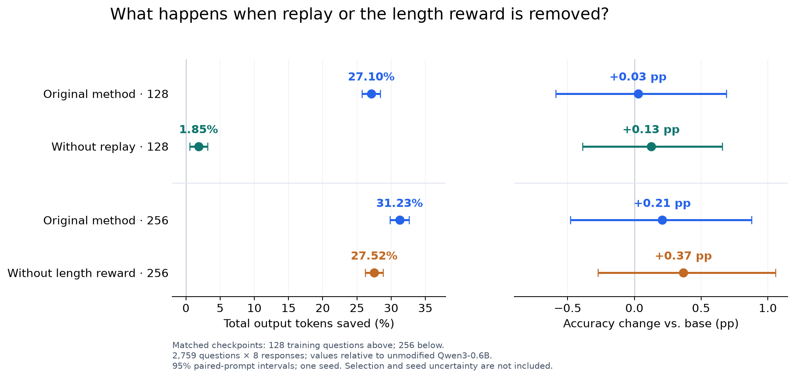
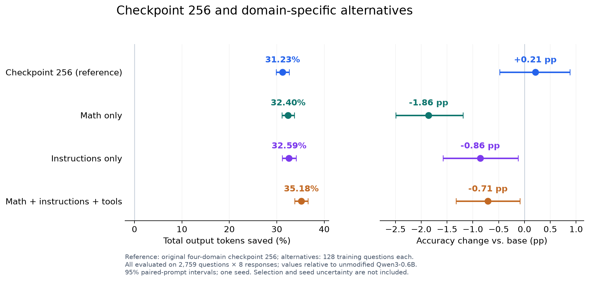
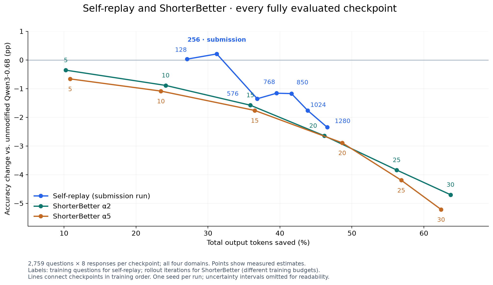

# Qwen3 Self-Replay

My submission for the [ThinkingCap contest](https://github.com/BottleCapAI/ThinkingCap-Test): teaching Qwen3-0.6B to give shorter answers while keeping reasoning enabled.

The model generates four answers per training question. Correct answers receive a length-based reward. When all four are correct, the shortest goes into a replay buffer for supervised training alongside reinforcement learning. No larger teacher model is used.

## Results

Checkpoint 256 is my main submission. Checkpoint 850 offers more compression at a larger accuracy cost.

| Checkpoint | Total tokens saved | Accuracy change | 95% accuracy interval | Evaluation |
|---|---:|---:|---:|---|
| **256 — main submission** | **31.23%** | **+0.21 pp** | −0.48 to +0.88 pp | 2,759 questions × 8 responses |
| 850 — alternative | 41.60% | −1.17 pp | −1.96 to −0.35 pp | 2,759 questions × 8 responses |

Both are compared with unmodified Qwen3-0.6B across math, coding, tool calling, and instruction following. Token counts include reasoning and final answers.

## What I tried next

I tested which parts of the method mattered. Removing replay produced much less shortening; removing the explicit length reward kept much of it. That branch still replays the shortest correct answer, so it retains a preference for brevity.



I also built a fixed dataset of **512 training questions and 256 separate development questions**. A hosted Qwen3-0.6B API helped screen training questions by difficulty and answer length. Its answers were used for selection, not as training targets.

On that dataset, I compared replay alone with reinforcement learning plus replay, then tried stricter and looser correctness requirements and different limits on reusing answers.

Finally, I trained three 128-question variants: math only, instructions only, and math plus instructions plus tools. Each was evaluated across all four domains.



These runs shortened answers further, but none gave me a clear reason to replace checkpoint 256. They also changed the data and replay setup, so this comparison does not isolate the effect of training domain.

## ShorterBetter experiments

I tested two ShorterBetter settings, α2 and α5, evaluating twelve checkpoints in total. Earlier checkpoints made smaller changes; later ones saved more tokens but lost more accuracy.



For this submission, I preferred checkpoint 256's balance. The [experiment reports](studies/README.md) retain the earlier trials and negative results.

## Limitations

These are single-seed experiments, and I inspected benchmark results while choosing checkpoints. The confidence intervals do not cover that selection or variation between training runs, and they do not establish unchanged accuracy.

Aggregate results also hide regressions: checkpoint 256 loses **4.17 pp** on tool questions where no call is needed.

## Reproduce and inspect

Use Python 3.11 from a source checkout. Download `self-replay-frozen-data.zip` from the [release](https://github.com/matousek-martin/qwen3-self-replay/releases/latest) into the repository root first.

```bash
python -m venv .venv
source .venv/bin/activate
pip install -e '.[dev,analysis]'

self-replay init workspaces/replay --recipe self-replay
python -m zipfile -e self-replay-frozen-data.zip artifacts/frozen-data
self-replay stage-data artifacts/frozen-data workspaces/replay/data/replay-scaled
self-replay train self-replay --workspace workspaces/replay --dry-run

python scripts/build_figures.py
pytest -q
```

This prepares the main experiment, prints its training command, and rebuilds the saved figures. Actual training requires the pinned GPU environment, supported hardware, and the setup in the [reproduction guide](docs/REPRODUCING.md). That guide also explains how to recompute the submitted results from saved responses without a GPU.

The newest balanced/fresh/domain branches are summarized here; their launch workflows remain in the research archive and are not supported public CLI recipes.

## Use the adapters

Download the [256 or 850 adapter](https://github.com/matousek-martin/qwen3-self-replay/releases/latest) and extract it into a folder such as `Qwen3-0.6B-Self-Replay-256`. In the model environment from `requirements/gpu.lock`:

```python
from transformers import AutoModelForCausalLM, AutoTokenizer
from peft import PeftModel

base_id = "Qwen/Qwen3-0.6B"
revision = "c1899de289a04d12100db370d81485cdf75e47ca"
tokenizer = AutoTokenizer.from_pretrained(base_id, revision=revision)
base = AutoModelForCausalLM.from_pretrained(
    base_id, revision=revision, torch_dtype="auto"
)
model = PeftModel.from_pretrained(base, "./Qwen3-0.6B-Self-Replay-256")
# Keep thinking enabled and use the model's normal chat template.
```

For contest evaluation, use the pinned evaluator with `--adapter` and unchanged prompts, sampling, and token caps; see [evaluation settings](docs/EVALUATION.md).

[IDEA.md](IDEA.md) explains the method and submission. I used coding agents for implementation, debugging, experiment tooling, and documentation; selected redacted conversations and tool-event metadata are included with the submission.

Code and adapters: Apache-2.0. Dataset and dependency attribution: [THIRD_PARTY_NOTICES.md](THIRD_PARTY_NOTICES.md).
