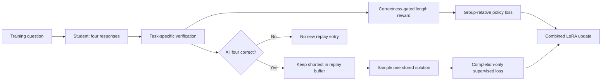
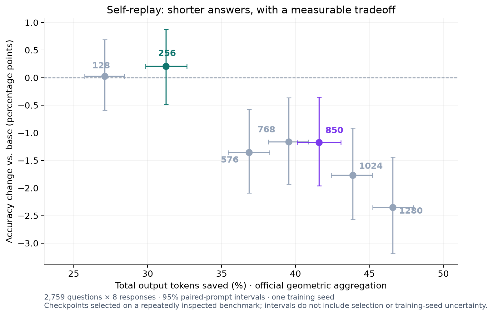
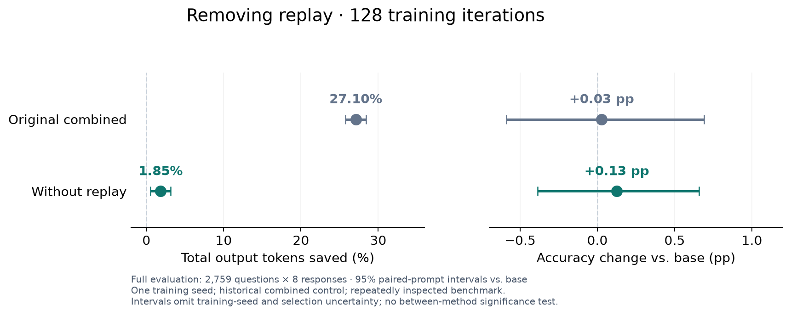
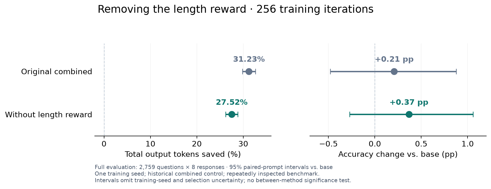

# Qwen3 Self-Replay

### Shorter reasoning from the model's own verified solutions

I train Qwen3-0.6B with two complementary signals: **reward correct, shorter answers**, and **rehearse a short solution only after the model solves its question correctly in all four sampled attempts**. The main lineage uses the student's own answers, with no external teacher. Thinking stays enabled.

**Checkpoint 256 uses 31.23% fewer total output tokens, with a +0.21 percentage-point accuracy estimate** on the full [ThinkingCap Test](https://github.com/BottleCapAI/ThinkingCap-Test). The 95% accuracy interval is [−0.48, +0.88] pp: promising compression, but no proof of improvement or equivalence.

## The idea

A length penalty alone can reward giving up. I instead keep every verified-correct response above every incorrect response in raw reward, then apply a small preference for brevity among correct answers.

Policy optimization learns from the relative rewards of four attempts. Replay adds a different signal: retain the shortest solution from a question with **4/4 verified-correct attempts**, then practice one stored solution alongside each new rollout group. The intent is to reinforce concise behavior the student can already produce reliably. Whether this gate is better than simpler alternatives is a hypothesis that needs a matched ablation.



The diagram shows admission; once the buffer has entries, a replay sample is used even when the current question fails the gate. The buffer holds at most 128 questions, and a newly admitted solution can be sampled immediately.

**Why both signals?** An all-wrong group has no relative policy signal, but an existing replay buffer can still provide a verified target. An all-correct group can favor shorter answers through the policy loss and also contribute its shortest answer to future replay. These are properties of the update rule, not evidence that replay alone caused the measured gain.

Read the [research summary](IDEA.md) for the rationale and findings, or the [method specification](docs/METHOD.md) for equations, pseudocode, a worked example and links to the actual training source.

## What I measured

| Checkpoint | Total tokens saved | Accuracy change | 95% accuracy interval | Role |
|---|---:|---:|---:|---|
| **256** | **31.23%** | **+0.21 pp** | **[−0.48, +0.88] pp** | Primary submission |
| 850 | 41.60% | −1.17 pp | [−1.96, −0.35] pp | Stronger compression, measured regression |
| 1280 | 46.58% | −2.35 pp | [−3.19, −1.44] pp | Later training exposes the tradeoff |



Each point uses **2,759 questions × 8 responses**, with equal domain weighting across SVAMP, MBPP+, BFCL and IFEval. Token savings use the official geometric aggregation and count **all output tokens**, including reasoning and final answers. Checkpoint numbers count processed training questions.

I select **256** for its substantial compression and accuracy estimate near the baseline. **850** shows a useful second operating point, with an explicit accuracy cost. All seven evaluated checkpoints remain visible; later training shortened outputs further while worsening aggregate accuracy.

## Component comparisons

Each chart compares one component removal with the original combined method at the **same number of training iterations**, using the same official evaluation. Both branches start from the pinned base with seed 17 and the original question order; the combined controls come from the earlier trajectory.





Removing replay reduces token savings from **27.10% to 1.85%** at 128 iterations. Removing the explicit length reward retains **27.52% savings**, versus **31.23%** for the combined method at 256. This suggests replay contributes much more to shortening in these runs, but the no-length-reward branch still replays the **shortest** answer from all-correct groups. It does not remove every preference for shorter answers.

Neither ablation establishes an aggregate accuracy improvement; both accuracy intervals include zero. The no-length-reward branch still loses **3.39 pp on BFCL no-call accuracy**. These are one-seed comparisons with historical controls, not a factorial study or a test of the difference between methods. [Verified source manifests](studies/self-replay/ablations/) link each chart to its full-evaluation evidence.

## What the experiments taught me

- Earlier replay-selection and adaptive-replay screens produced longer outputs on average; permissive admission and adaptive rewards did not automatically improve the tradeoff.
- Teacher replay compressed answers but harmed its separate validation accuracy, while on-policy distillation did not pass its compression screen.
- ShorterBetter's twelve evaluated snapshots showed growing compression alongside accuracy loss; inspecting earlier checkpoints mattered.
- Coding follow-ups did not establish a superior replacement for the main checkpoint.

Those earlier experiments used different cohorts and controls. They informed the research direction; they are **not the component comparisons above**. The [experiment findings](studies/README.md) retain negative results, incomplete runs and development-only evidence separately.

## What the result does not establish

**The strongest evidence is for the reported configurations and checkpoints.** The component comparisons provide initial evidence about removing replay or the explicit length reward, but do not isolate the 4/4 gate, shortest-answer selection or interactions between components. I do not claim to have invented group-relative optimization or supervised replay.

- BFCL no-call accuracy falls **4.17 pp at 256** and **6.88 pp at 850**; aggregate accuracy hides this regression.
- The main trajectory has one training seed, and repeatedly inspected benchmarks influenced checkpoint selection.
- The confidence intervals do not capture training-seed variability or correct for that selection.
- Verification is task-specific; lexical contamination screening does not prove zero semantic overlap.

A useful next study would repeat the component comparisons across seeds and compare all-correct with any-correct replay under the final four-domain protocol. Those multi-seed and gate comparisons are not available here.

## Reproduce and inspect

The code retains **24 method entrypoints**, including unsuccessful experiments. Start with the method and evidence, then use the engineering tools to reproduce or extend them:

| Resource | Purpose |
|---|---|
| [IDEA.md](IDEA.md) / [method specification](docs/METHOD.md) | Rationale, update rule and research conclusions |
| [Experiment findings](studies/README.md) | Main trajectory, negative results and protocol distinctions |
| [Reproduction](docs/REPRODUCING.md) / [method recipes](docs/METHODS.md) | Data, environments, training and required inputs |
| [Evaluation contract](docs/EVALUATION.md) | Official settings, cached-baseline provenance and offline recomputation |
| [GPU smoke evidence](studies/gpu-smoke/2026-11-07/README.md) | Fresh training/resume and both adapters tested on 2×A100; verified backup/release |
| [Other-method GPU checks](studies/gpu-smoke/2026-11-07-other-methods/README.md) | All 21 single-4090 recipes passed bounded updates/checkpoint checks; failures retained |
| [RunPod / Vast](docs/CLOUD.md) | Finite job planning, monitoring, backup and release |
| [AI usage](AI_USAGE.md) | My research direction, substantial AI assistance and validation |

Python 3.11+, from a source checkout:

```bash
python -m venv .venv
source .venv/bin/activate
pip install -e '.[dev,analysis]'
self-replay init workspaces/replay --recipe self-replay
self-replay train self-replay --workspace workspaces/replay --dry-run
python scripts/build_figures.py
pytest -q
```

These commands prepare local files, display the training command and rebuild plots. Actual training needs the pinned scientific environment, prepared data and verified permitted hardware. Downloadable adapters, saved responses, frozen data and the contest ZIP are in the [release](https://github.com/matousek-martin/qwen3-self-replay/releases/latest).

## Use the adapters

Download the [256 and 850 adapters from the release](https://github.com/matousek-martin/qwen3-self-replay/releases/latest). Extract the chosen archive into a folder such as `Qwen3-0.6B-Self-Replay-256`; these are PEFT adapters, so the pinned base model is also required.

```python
from transformers import AutoModelForCausalLM, AutoTokenizer
from peft import PeftModel

base_id = "Qwen/Qwen3-0.6B"
revision = "c1899de289a04d12100db370d81485cdf75e47ca"
tokenizer = AutoTokenizer.from_pretrained(base_id, revision=revision)
base = AutoModelForCausalLM.from_pretrained(base_id, revision=revision, torch_dtype="auto")
model = PeftModel.from_pretrained(base, "./Qwen3-0.6B-Self-Replay-256")
# Keep thinking enabled and apply the model's normal chat template.
```

For contest evaluation, use the pinned evaluator with `--adapter`; do not substitute a custom prompt, disable thinking or reduce the output cap.

## Provenance and license

`src/self_replay/` exposes data, methods, evaluation and cloud operations; `configs/` holds recipes, `studies/` holds evidence, and `provenance/` binds artifacts to hashes. Historical scientific source overlays preserve the implementation used for the reported runs. The original plan contains 3,840 questions; the reported trajectory reached 1,280. Inference adapters do not contain optimizer/replay/RNG state.

The Git history retains the actual upstream evaluator history, followed by a dated research import and refactor; original experiment chronology comes from preserved records. See [HISTORY.md](docs/HISTORY.md).

My code and released adapters: Apache-2.0. Base model, evaluator, dataset and vendored-code attribution remain in [THIRD_PARTY_NOTICES.md](THIRD_PARTY_NOTICES.md); research data is not relicensed as software.
